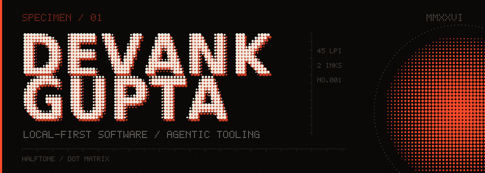
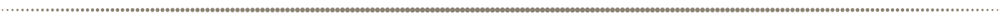
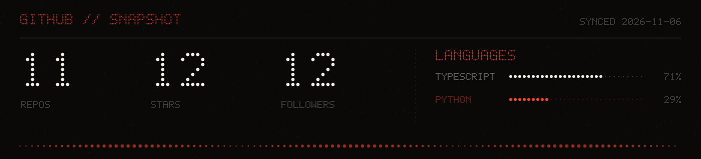

I build software that runs on your machine and agents that do real work inside the tools you already use. The things I make keep their data in files you own, and most of them work without an account.

- 🔭 Building local-first desktop apps and agent tooling
- 🌱 Reading up on MCP servers and local inference
- 💬 Happy to talk about local-first architecture, Tauri, or MediaPipe hand tracking
- ⚡ One React codebase, two storage engines: SQLite inside Tauri, IndexedDB on the web

| FIELD | SPEC |
| :-- | :-- |
| APPS | Tauri · React · Next.js · Three.js · Tailwind |
| SYSTEMS | Node.js · Express · Python · Docker · GitHub Actions |
| AI | MediaPipe · faster-whisper · MCP · Gemini |
| TOOLS | Git · Linux · Obsidian · Figma |

