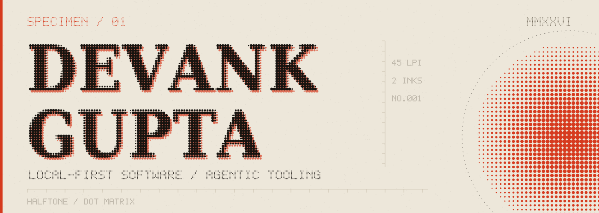
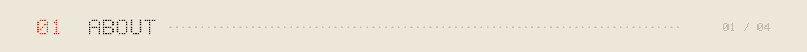
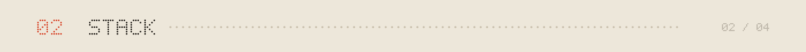
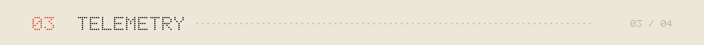
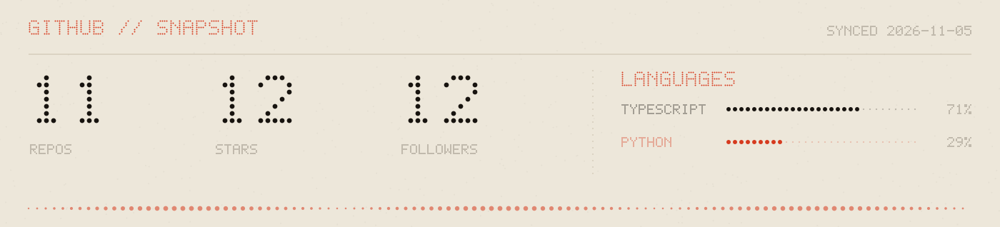
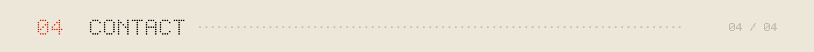
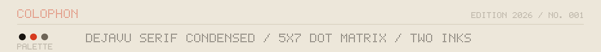

<picture>
  <source media="(prefers-color-scheme: dark)" srcset="assets/banner.svg">
  
</picture>

<picture>
  <source media="(prefers-color-scheme: dark)" srcset="assets/sec-about.svg">
  
</picture>

I build local-first software and agent tooling. The work keeps its data in files you own, and most of it runs without an account.

Right now that means desktop apps with local storage, and agents that plug into tools people already use.

- Building local-first desktop apps and agent tooling
- Reading up on MCP servers and local inference
- Happy to talk about local-first architecture, Tauri, or MediaPipe hand tracking

<picture>
  <source media="(prefers-color-scheme: dark)" srcset="assets/sec-stack.svg">
  
</picture>

| FIELD | SPEC |
| :-- | :-- |
| `LANGUAGES` | TypeScript · Python · JavaScript |
| `FRONTEND` | React · Next.js · Tailwind · Three.js |
| `DESKTOP` | Tauri · SQLite · IndexedDB |
| `BACKEND` | Node.js · Express · REST APIs |
| `AI` | MediaPipe · faster-whisper · MCP · Gemini |
| `INFRA` | Docker · GitHub Actions · Linux |
| `TOOLS` | Git · Obsidian · Figma · VS Code |

<picture>
  <source media="(prefers-color-scheme: dark)" srcset="assets/sec-telemetry.svg">
  
</picture>

<picture>
  <source media="(prefers-color-scheme: dark)" srcset="assets/stats.svg">
  
</picture>

<picture>
  <source media="(prefers-color-scheme: dark)" srcset="assets/sec-contact.svg">
  
</picture>

<picture>
  <source media="(prefers-color-scheme: dark)" srcset="assets/colophon.svg">
  
</picture>
